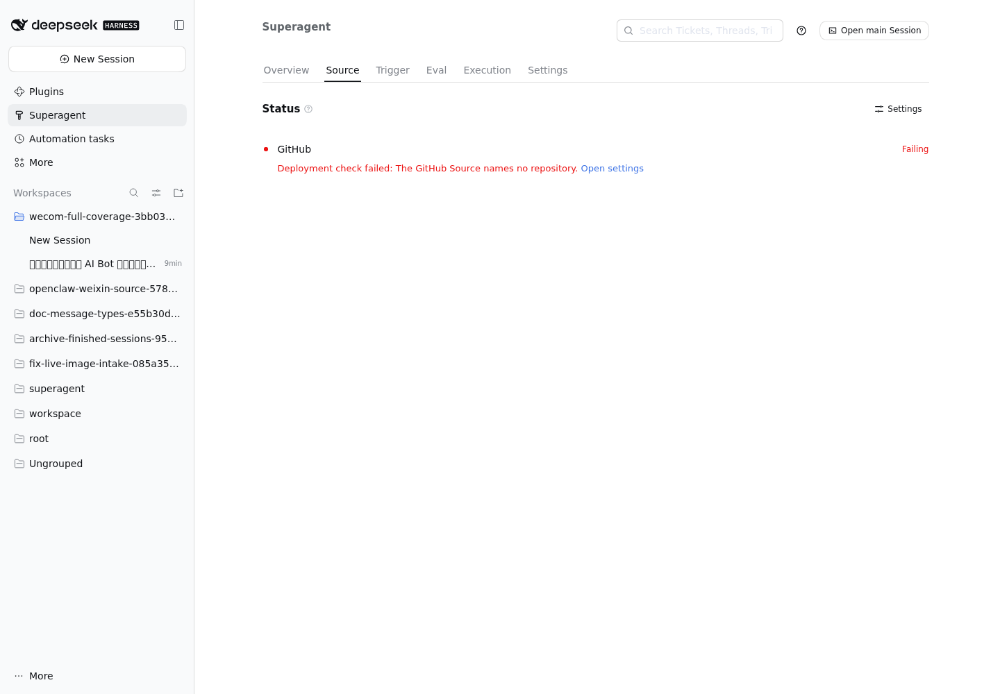
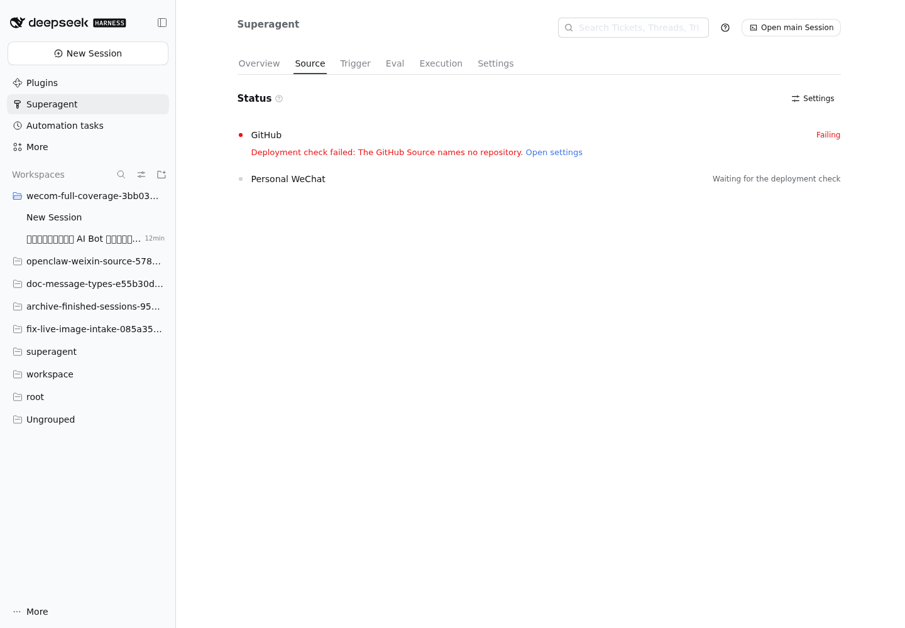

# 个人微信 Source：实现与接入

本文说明 dsh-superagent 的个人微信 Source。它把一个个人微信号接到 Superagent，接收单聊消息、创建工单并在原会话回复。实现使用腾讯 iLink bot 网关协议，与官方 OpenClaw 插件 `@tencent-weixin/openclaw-weixin` 相同，但**不依赖 OpenClaw 进程**，也不需要运行 `@tencent-weixin/openclaw-weixin-cli` 安装器。

## 1. 结论

| 项目 | 说明 |
| --- | --- |
| Source kind | `weixin` |
| 入口 | `src/weixin-watch.ts`，导出为 `./weixin-watch` |
| 登录 | `node scripts/weixin-login.mjs` 扫码，写出 0600 凭证文件 |
| 收消息 | `getupdates` 长轮询，游标保存在 Source 的 KV 中 |
| 发消息 | `sendmessage` 文本回复，带回会话最新的 `context_token` |
| 会话 | 每个微信用户一个 Thread（`direct:<user id>`），后续消息唤醒已有工单 |
| 并发限制 | 同一个 token 同时只能有一个 `getupdates` 消费者；不要和 OpenClaw Gateway 同时使用同一账号 |

## 2. 登录与配置

### 2.1 扫码登录

```sh
node scripts/weixin-login.mjs
```

脚本会：

1. 调用 `ilink/bot/get_bot_qrcode` 获取二维码并在终端显示；
2. 轮询 `ilink/bot/get_qrcode_status`，处理已扫码、IDC 重定向、验证码、二维码过期刷新；
3. 确认后把 `token`、`baseUrl`、`accountId`、`userId` 写入
   `$DSH_HOME/state/superagent/weixin-account.json`（默认 `~/.dsh/...`，目录 0700、文件 0600）。

可选参数：`--out <path>` 指定凭证文件，`--base <url>` 指定网关，`--print-token` 同时打印 token。

> 如果这个微信号已经绑定过 OpenClaw，登录可能返回 `binded_redirect`，不会签发新 token。请先在 OpenClaw 侧解绑，或直接复用已有的 OpenClaw 账号凭证。

### 2.2 Source 设置

启用插件后，Sources 设置里会多出「个人微信」卡片；下面是在同一空配置下、启用前后截取的面板对比（基线为未包含本 Source 的构建）：

| 启用前 | 启用后 |
| --- | --- |
|  |  |


在面板的 Source 设置中启用「个人微信」，填写：

| 字段 | 说明 |
| --- | --- |
| `accountFile` | 登录脚本写出的 JSON 路径；相对路径在 Superagent 状态目录下。优先于 `token`。 |
| `token` | 也可以直接粘贴 token；保存在本机 0600 的状态数据库。 |
| `accountId` | 可选；区分轮询游标和健康信息。登录文件里有账号 id 时留空即可。 |
| `baseUrl` | 默认 `https://ilinkai.weixin.qq.com`；扫码发生 IDC 重定向时登录文件会记录新地址。 |
| `pollTimeoutSeconds` | 长轮询超时，默认 35 秒；网关可建议其他值。 |

### 2.3 策略

```json
{
  "weixin": {
    "allowed": [
      { "id": "<微信用户 id>", "name": "<备注名>" }
    ],
    "admission": {}
  }
}
```

只有 `allowed` 中的微信用户能发起明确工作。个人微信只接收单聊；每条单聊都算“点名”了机器人。未在名单里的发送者默认被过滤，是否作为候选由准入表的 `direct` 行决定。

### 2.4 执行环境变量

| 变量 | 值 |
| --- | --- |
| `DSH_SUPERAGENT_WEIXIN_CHAT` | 触发工单的微信用户 id |
| `DSH_SUPERAGENT_WEIXIN_ACCOUNT` | 触发工单的微信用户 id |

## 3. 数据流

```text
手机微信
   │  iLink 网关（HTTPS）
   ▼
src/weixin-api.ts  getupdates 长轮询
   │  weixinTrigger()：文本、图片、文件、视频、语音转写、引用
   │  prepareWeixinMedia()：CDN 下载 + AES-128-ECB 解密落盘
   ▼
ctx.receive(trigger) → Eval → Ticket → Executor
   │  outbox 产生回复
   ▼
src/weixin.ts channel.send()
   │  sendmessage（文本 + context_token）
   ▼
手机微信
```

游标 `get_updates_buf` 按账号保存在 `weixin-updates-buf:<account>`；每个用户最新的 `context_token` 保存在 `weixin-context-token:<user>`，重启后仍能回复。Trigger id 由 `message_id` 派生，网关重投时由 Store 去重。

## 4. 消息类型支持

| 类型 | 支持 | 说明 |
| --- | --- | --- |
| `text` | ✅ | 原样作为消息文本。 |
| `image` | ✅ | 在 CDN 链接过期前下载、按 AES-128-ECB 解密，按魔数校验 PNG/JPEG/WebP/GIF，保存为评估附件。 |
| `voice` | ✅（转写） | 使用网关返回的 `voice_item.text`；没有转写时文本为 `[语音消息，微信未提供转写文本]`。不下载/转码 SILK 音频。 |
| `file` | ✅ | 解密落盘（单条 20MB 上限），消息文本给出绝对路径，评估可用文件工具读取。 |
| `video` | ✅ | 解密落盘，消息文本给出绝对路径；不会把视频作为视觉输入。 |
| 图文混排 | ✅ | 按 `item_list` 原顺序保留文本、图片、文件、视频标记。 |
| 引用 `ref_msg` | ✅ | 有内联内容时直接渲染；只有 `svr_id` 时从进程内最近 500 条缓存还原（入站消息和本 Source 的出站回复都会缓存），否则标记 `[引用消息内容未缓存]`。引用中的图片/文件/视频也会下载。 |
| 机器人消息 | 跳过 | `message_type = 2` 不创建 Trigger，避免自回环。 |
| 群聊 | 不支持 | 个人微信 Source 只处理单聊；群聊消息不作为工单来源。 |
| 出站图片/视频/文件/语音 | ✅ | 回复里用 Markdown 图片/链接或 `MEDIA:` 指定本地绝对路径，发送时上传到微信 CDN；其余文本作为说明。单条 20MB。 |

媒体保存在 `<stateDir>/weixin-media/<message id>/`（目录 0700、文件 0600）。下载失败不会丢消息：对应标记变成 `[图片不可用]`、`[文件不可用]` 或 `[视频不可用]`。

### 4.1 出站媒体写法

DSH 的回复正文是文本，因此用以下任一写法让 Source 把本地文件发到微信：

```text
看图 ![图表]（本地图片绝对路径）
报告在 [report.pdf]（本地文件绝对路径）
MEDIA:（本地视频绝对路径）
```

（示例中的中文括号是占位说明；实际写成 Markdown 图片、Markdown 链接或 `MEDIA:` 行，目标为本地绝对路径。）

- 图片扩展名：png/jpg/jpeg/gif/webp → 图片消息；
- mp4/mov/webm/mkv/avi → 视频消息；
- mp3/ogg/wav/silk/amr → 语音消息；
- 其他扩展名 → 文件消息；
- 只接受存在的本地绝对路径（也接受 `file://`），URL 和相对路径保持为文本；
- 上传前会按扩展名分类，AES-128-ECB 加密后 POST 到 CDN；单条上限 20MB；
- 同一条回复先发剩余文本，再逐个发媒体；重试复用确定性的 `client_id`。

## 5. 可靠性与限制

- 长轮询按网关建议的超时时间运行；网络失败 2 秒重试，连续 3 次失败退避 30 秒。
- 网关返回 `errcode = -14` 表示 token 过期：Source 报告错误并暂停轮询，需重新运行登录脚本；替换凭证文件后下一轮自动生效，无需重启。
- 同一个 token 只能有一个消费者。OpenClaw Gateway 和本 Source 同时运行会互相抢消息，必须停掉其中一个。
- 引用缓存只在内存中，进程重启后只能依赖消息内联的引用内容。
- 不发送输入状态，不处理微信侧 slash command；这些属于 OpenClaw 运行时能力，不是本 Source 的职责。
- 只支持一个 Source 实例对应一个账号；多账号需要多个部署或后续扩展。

## 6. 验证

`tests/weixin.spec.ts` 覆盖：消息渲染与引用、Trigger/Policy/Scope/环境变量、凭证文件优先级、`uint64` 消息 id 解析、`getupdates`/`sendmessage` 请求与鉴权头、游标和 `context_token` 持久化、图片下载解密与不可用标记、本地媒体提取与 CDN 上传后发送。

```sh
pnpm exec vitest run tests/weixin.spec.ts
pnpm typecheck
pnpm build
```

真实扫码和收发消息需要可用的微信账号，无法在自动化测试中覆盖。
